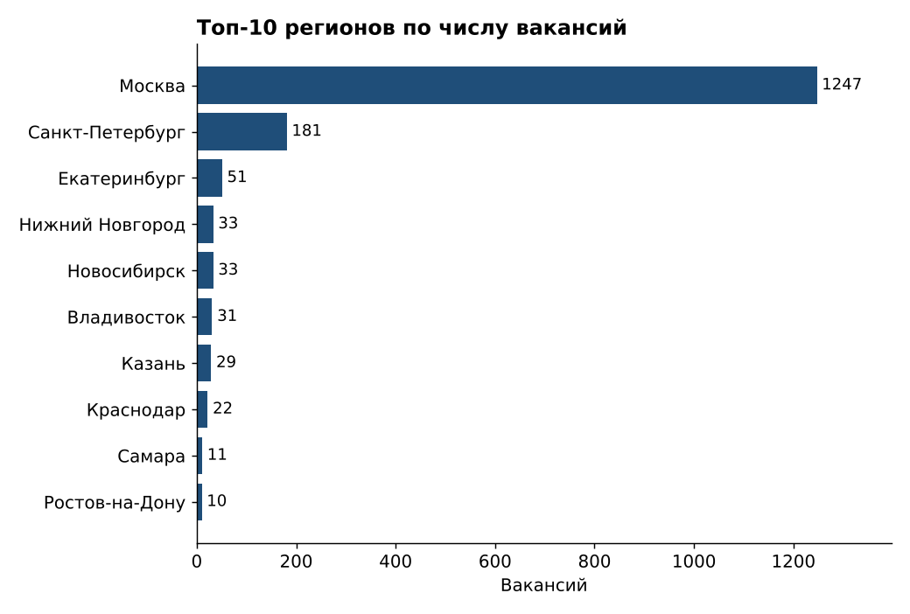
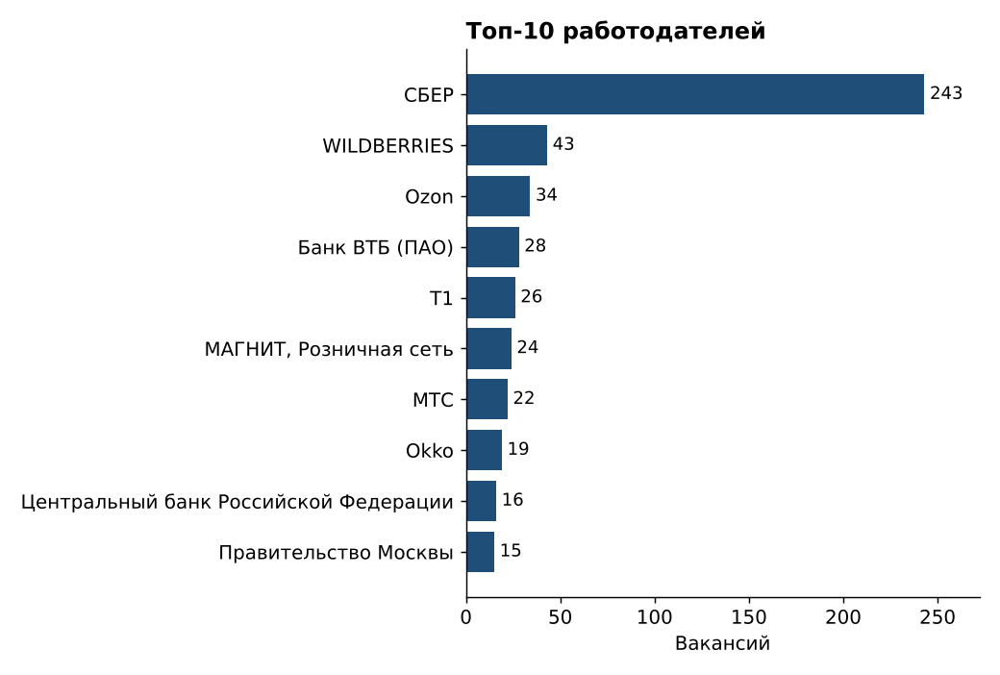
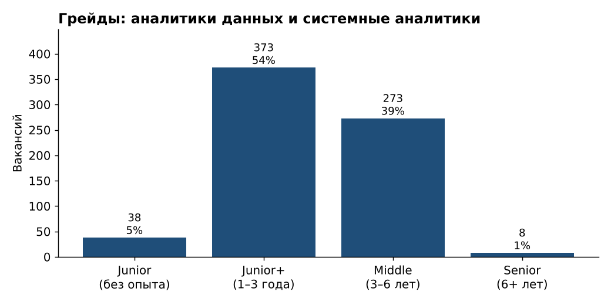
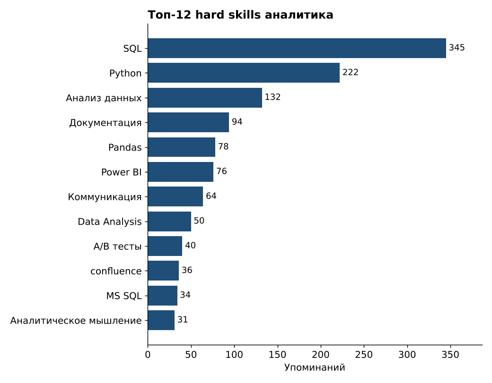
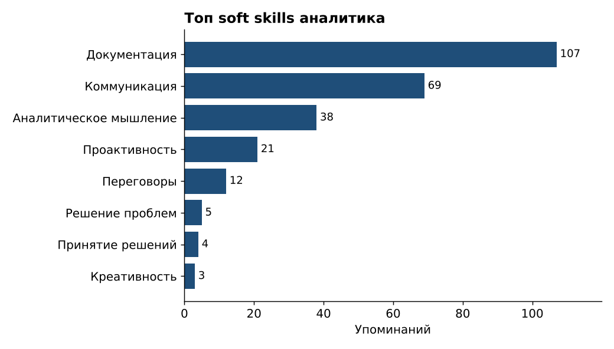
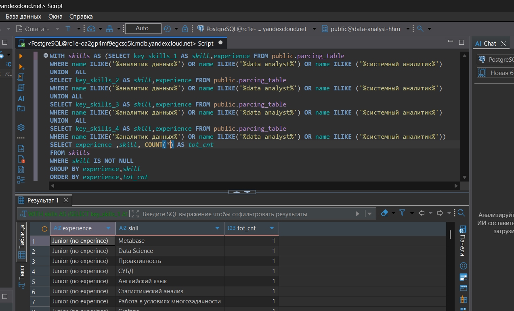

# Анализ рынка вакансий аналитиков (hh.ru)

**Инструменты:** PostgreSQL (Yandex Cloud), DBeaver, Google Sheets
**Данные:** таблица `public.parcing_table` — 1801 вакансия, спарсенная с hh.ru
(название, работодатель, регион, опыт, график, занятость, зарплатная вилка, по 4 hard и soft skills).

## Задачи

1. Определить диапазон зарплат: средние, минимумы и максимумы нижней и верхней границы.
2. Найти регионы и компании с наибольшим числом вакансий.
3. Выяснить, какие типы занятости и графики работы преобладают.
4. Изучить распределение грейдов (Junior, Middle, Senior) среди аналитиков данных и системных аналитиков.
5. Выявить основных работодателей, их зарплаты и условия труда для аналитиков.
6. Определить самые востребованные hard и soft skills по грейдам.

## Результаты

### 1. Зарплаты

| | Нижняя граница (от) | Верхняя граница (до) |
|---|---:|---:|
| Среднее | 109 525 ₽ | 153 847 ₽ |
| Минимум | 50 ₽* | 25 000 ₽ |
| Максимум | 398 000 ₽ | 497 500 ₽ |

\* выброс, ошибка в данных.

Запрос: [`queries/01_salary.sql`](queries/01_salary.sql)

### 2. Регионы и компании

Москва — 1247 вакансий (~69%), Санкт-Петербург — 181, Екатеринбург — 51.
Крупнейший работодатель — Сбер (243 вакансии), за ним WILDBERRIES (43) и Ozon (34).

Запрос: [`queries/02_regions_employers.sql`](queries/02_regions_employers.sql)

### 3. Занятость и график

Полная занятость — 98% вакансий. Полный день — 80%, удалёнка — 17%.

Запрос: [`queries/03_employment_schedule.sql`](queries/03_employment_schedule.sql)

### 4. Грейды (аналитики данных + системные, 692 вакансии)

| Грейд | Вакансий | Доля |
|---|---:|---:|
| Junior+ (1–3 года) | 373 | 53,9% |
| Middle (3–6 лет) | 273 | 39,5% |
| Junior (без опыта) | 38 | 5,5% |
| Senior (6+ лет) | 8 | 1,2% |

Запрос: [`queries/04_grades.sql`](queries/04_grades.sql) — доля считается оконной функцией `SUM(COUNT(id)) OVER ()`.

### 5. Работодатели

Больше всего вакансий аналитиков у Сбера (134, полный день, средняя вилка ≈ 126–131 тыс. ₽).
Большинство работодателей зарплату не указывают.

Запрос: [`queries/05_employers_conditions.sql`](queries/05_employers_conditions.sql)

### 6. Навыки

- **Hard skills:** SQL (345 упоминаний), Python (222), анализ данных, документация, Pandas, Power BI.
  На Middle растёт роль A/B-тестов и ML.
- **Soft skills:** документация (107), коммуникация (69), аналитическое мышление (38), проактивность (21).

Навыки хранятся в четырёх столбцах, поэтому для подсчёта они объединены через `UNION ALL` в CTE.
Запросы: [`queries/06_1_hard_skills.sql`](queries/06_1_hard_skills.sql), [`queries/06_2_soft_skills.sql`](queries/06_2_soft_skills.sql).

Запрос по hard skills в DBeaver:

## Особенности данных

- Пустые навыки записаны как пустая строка `''`, а не `NULL`.
- В части soft skills есть пробел в начале названия — нужен `TRIM`.
- Опечатка в значении грейда: `Junior (no experince)`.

## Файлы

- `queries/` — SQL-запросы по каждой задаче
- `images/` — графики и скриншот из DBeaver
- `results/` — выгрузки результатов по каждой задаче (CSV)
